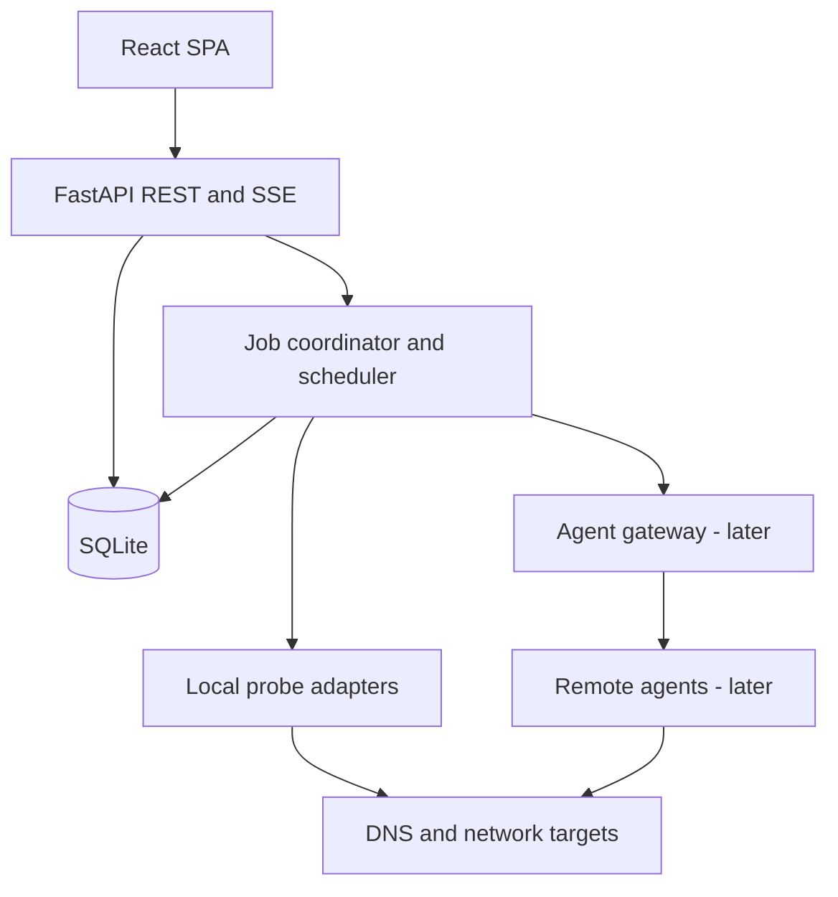

# Network Diagnostics Center — architecture v1

Status: proposed foundation, not implemented. Based on DNS Benchmark v0.2.0.
The current repository, existing CasaOS installation, port 8099, data mount and
legacy export format are retained. No changes to AdGuard Home or NetBird.
Product name is provisional; repository/image names remain unchanged.

## Principles
- Local-first, self-hosted, one container for the standalone edition; no cloud
  account, telemetry, Redis, PostgreSQL or privileged container required.
- Modular monolith with explicit boundaries; no arbitrary shell execution.
- Accurate, reproducible network measurements before adding more modules.
- Local and remote results use the same versioned measurement contract.
- Preserve existing history; ship additive migrations with a backup and rollback plan.
- Network traffic from a Docker bridge is not assumed equivalent to traffic from
  the host or another container. Every result identifies its vantage point.

## Components
React + TypeScript + Vite; TanStack Router and Query; Tailwind CSS with custom
design tokens; ECharts. Use a locked dependency tree. FastAPI/Python remains
the control plane and initial execution engine. SQLite WAL, foreign keys,
busy timeout and Alembic migrations. Serve the built SPA and API from one
origin using a multi-stage image, without a Node runtime in the final image.
One Uvicorn process initially; bounded execution pool separate from request
handling; persistent jobs and scheduler owned by a single coordinator.
SSE for progress, with polling/reconnect fallback. REST is authoritative.

## Target repository layout
- web/src/app: routing, providers, shell
- web/src/features: dashboard, benchmark, dns-inspector, connectivity, tls,
  routes, monitors, history, agents, settings
- web/src/shared: components, charts, api client, types, utilities
- backend/ndc/api: request models, routes, SSE, auth
- backend/ndc/core: configuration, lifecycle, security
- backend/ndc/jobs: state machine, cancellation, scheduler, limits
- backend/ndc/probes: DNS transport adapters, connectivity, TLS, route
- backend/ndc/storage: repositories, migrations, retention, legacy import
- backend/ndc/analytics: percentiles, comparisons, diagnostics
- contracts/: versioned OpenAPI and agent protocol
- agents/: optional Go implementation after feasibility gate
- tests/: fixtures, deterministic local integration, browser and migration tests
- deploy/: standalone, CasaOS, optional agent deployment
- docs/: architecture, product, roadmap, ADRs

## API and job lifecycle
Versioned REST prefix /api/v1; keep legacy read/export compatibility during
migration. Routes: GET /capabilities, CRUD /profiles and /targets,
POST /runs, GET /runs/{id}, GET /runs/{id}/samples,
POST /runs/{id}/cancel, GET /runs/{id}/events, GET /history,
GET /runs/{id}/export?format=json|csv. Later /monitors, /agents, /diagnostics.
Validate target, protocol, duration, packet and concurrency limits server-side.
Return 202 with run id on creation; persisted states queued, running,
cancelling, cancelled, completed, failed, interrupted. Cancellation cooperative
with bounded I/O timeouts; no new work after cancellation. A restart marks
orphaned running jobs interrupted; never silently rerun them. Store partial
results. SSE events have sequence IDs; reconnect loads authoritative state
and resumes or refreshes when event history is gone. Avoid multiple workers
executing the same job. Job limits and retention configurable with conservative defaults.

## Data model
- targets: logical endpoint, scheme, port, label, expected policy, enabled
- profiles: targets, query corpus/version, family, mode, timeout, concurrency
- agents: id, capabilities, engine version, vantage point, heartbeat
- runs: immutable profile snapshot, state, timestamps, version, origin
- samples: run, target, mode, agent, requested/observed transport, actual peer IP,
  query, qtype, outcome, error code/type/message, timing, connection reuse status
- summaries: success/failure counts, latency percentiles, variability, sample count
- monitors: interval, target, thresholds, next execution; monitor_events
- settings, schema version and migration/import ledger.
Use UTC and monotonic clocks for durations. Do not store secrets in result payloads.
Persist legacy JSON unchanged with schema_version=legacy and import markers;
do not infer missing per-query timings or connection reuse.
Back up SQLite using its backup API (including WAL consistency) before migrations.
Keep existing /data mount and uid 10001; verify upgrade on a copy of the old database.
Retention default proposal: raw samples 30 days, summaries 180 days, manual exports
not deleted by application; user can adjust and inspect disk usage.

## Measurement correctness
Current implementation: global in-memory state, two-worker pool, a JSON blob per
run, one selected address per endpoint, eight repeated A-query names, warmup
excluded even on failure, and smoke CI only. IPv4 selection improved H3 success
but warm H3 latency stayed near cold. This is evidence to investigate, not proof
of a particular QUIC failure.
- Benchmark cold creates a fresh transport session; DNS bootstrap timing separate.
- Warm excludes a successful warmup, verifies reuse with transport instrumentation;
  if reuse is not observable label unknown, do not claim it. Record reconnects
  separately and classify timing; failed warmup reported explicitly.
- Both pins the same actual IP, SNI/authority, query order, and options for both.
  Report requested and negotiated protocol (HTTP/1.1, HTTP/2, HTTP/3); no silent fallback
  under strict mode. Auto selection and fallback only when explicitly enabled.
- Record TCP connect, TLS/QUIC handshake, DNS exchange and total where measurable;
  unavailable phases are null, not estimates. Use monotonic clocks.
- DoH TLS verification enabled, hostname and SNI preserved on IP pinning.
  DoT and DoQ certificates verified; no insecure default. UDP TC handling
  explicitly configurable; DNS TCP supported separately.
- Transport success and DNS semantics distinct: NXDOMAIN may be a valid response;
  SERVFAIL, policy block, malformed answer, timeout, TLS and network errors distinct.
- DNS record types A/AAAA/CNAME/MX/TXT/NS/SOA/CAA/PTR; optional DNSSEC DO/AD
  observation is not independent cryptographic validation.
- Fixed query corpus for comparisons; warm transport is not synonymous with DNS
  cache warmth. Random-label testing only against owned/authorized test zones.
- Save raw samples, median, nearest-rank p95/p99, standard deviation labelled
  as latency variability (not RFC packet jitter). Mark low sample count and
  no-success null values. Do not rank an unreliable target above a stable one
  merely by latency. Report packet loss separately from DNS failure rates.
- Test local fixtures for protocol negotiation, SNI, validation, connection
  reuse, DNS semantics, cancellation, timeout and IPv4/IPv6.
- Spike: compare Python HTTP/3 transport to an instrumented Go implementation
  and an independent client from the same network. Pick one canonical engine
  before agents ship. If Go wins, extract a shared Go probe executable/service
  used both locally and remotely; do not maintain divergent measurement logic.
  Otherwise use the same Python engine for remote execution, with a Go agent
  supervisor only if it adds value.

## Network probes and permissions
Unprivileged TCP connect, HTTP timings, DNS, TLS are baseline. ICMP/traceroute
depend on OS/container permissions; detect capabilities, show unavailable rather
than pretending success. Optional dedicated runner with minimal capabilities
(e.g. NET_RAW only where necessary); never privileged or Docker socket.
Do not change firewall, DNS, routes or remote systems automatically.
Traceroute is a set of observed hops, not a verified geographic path; missing
ICMP replies do not imply packet loss at the destination. Separate IPv4/IPv6.
Speed tests optional and opt-in with byte/time quotas against approved endpoints.

## Distributed mode (later)
Outbound agent HTTPS on private NetBird network by default; authenticated
enrollment with single-use token, then per-agent scoped credentials and rotation;
mTLS or equivalent verified agent identity before production. No public agent
listener required. Heartbeats, version/capability handshake, task lease and expiry,
idempotent result upload keyed by job/agent/sample, bounded local spool with
backoff. Agent validates signed/authenticated task scope, protocol and target
allowlist. No generic shell or arbitrary code tasks. Store source/egress label,
agent version and clock confidence; durations measured locally. Controller
access restricted to trusted operators. Offline nodes show stale last seen,
not zero latency. Revoke agent, cancel tasks and audit operations.
Only test targets the operator owns or is authorized to probe, and public DNS
services within normal service usage. Limit scheduling and distributed fanout.

## Security / deployment
Trusted LAN only for legacy. Before remote or scheduled features: initial owner
setup, session auth, CSRF protection for writes, secure cookies under HTTPS,
rate limits, explicit target scopes (public or opted-in LAN CIDR/host), deny
cloud metadata/link-local by default, validate resolved IP and pin it, reject
redirects or revalidate destination, prevent DNS rebinding. No arbitrary URL
fetching or unauthenticated diagnostic proxy. Redact credentials, logs and
exports; no secrets in source. Auth required for agents and write operations.
Standalone image non-root, cap_drop ALL, no-new-privileges, read-only filesystem
where feasible with /data writable and tmpfs for temporary data. Keep port
8099 and mount /DATA/AppData/dns-benchmark. Document private bind/reverse proxy;
no external publication by default beyond existing LAN deployment.
CI: lint/typecheck/unit, local deterministic transport tests, migration fixture,
Playwright browser checks, image smoke, then controlled live opt-in diagnostics.
Work branches never publish edge. Main edge and immutable commit tag; stable
version tag only after acceptance. Test preview with separate data directory
and port 8100; rollback by previous image digest and consistent data backup.
